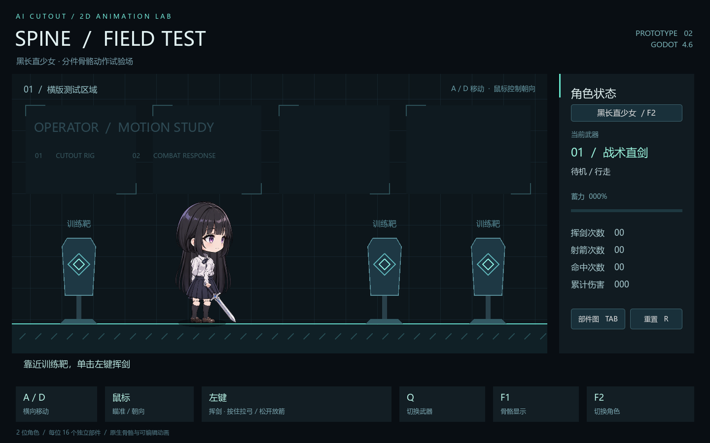
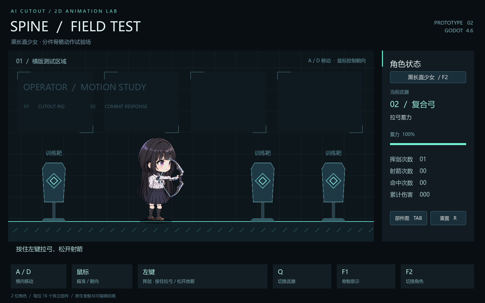

# Spine-test

用 AI 生成原创角色分件，再用 Godot 4.6 原生骨骼搭建可操作的横版测试场景。

现在有两位可切换角色：白发兽耳战术干员，以及穿白衬衫、深色百褶裙的黑长直少女。新角色的清秀气质参考千反田爱瑠；两人都保持明日方舟战斗小人方向的比例和线条。角色图由内置 image_gen 生成，每位角色使用 16 张透明分件 PNG、14 个 Bone2D 和可在编辑器中修改的 AnimationPlayer 关键帧。

默认登场的是黑长直少女，按 **F2** 或点击右侧角色名称按钮切换。





## 运行

1. 使用 **Godot 4.6.x** 导入本目录的 `project.godot`。
2. 等待素材导入完成，按 **F5** 运行主场景。
3. 向右移动靠近训练靶后挥剑，或切换弓在远处射击。左侧也有训练靶，可验证反向动作。

工程使用 Godot 自带的 2D 骨骼与动画系统，不依赖 Spine 插件、Spine 许可证或第三方运行库；不包含 `.spine` 专有工程。

## 操作

| 操作 | 默认映射 |
| --- | --- |
| 横向移动 | A / D |
| 瞄准和左右朝向 | 鼠标移动 |
| 挥剑 | 剑模式单击鼠标左键 |
| 拉弓 / 放箭 | 弓模式按住左键 / 松开左键 |
| 切换剑和弓 | Q |
| 切换角色 | F2 / 右侧角色名称按钮 |
| 显示或隐藏骨骼辅助线 | F1 |
| 打开或关闭原始部件图集 | Tab |
| 重置角色、箭矢和命中统计 | R |

所有映射均定义在 **项目 → 项目设置 → 输入映射**，代码通过 action 名称读取。拉弓中可以慢速移动；蓄满约需 0.8 秒，蓄力影响箭速和伤害。切换武器、切换角色、打开部件图或窗口失焦会取消当前攻击。切换角色保留当前位置、所持武器和骨骼显示状态，未选中的角色由 Godot 原生处理模式停用。打开部件图时暂停角色移动和攻击，F2 可直接比较两套素材。

## 修改角色与动画

打开 `scenes/operator_rig.tscn`：

- `Skeleton2D` 下的 `Hips` 是根骨骼，包含躯干、头发、衣摆、两侧腿和手臂。
- 每个部件都是骨骼下的 `Sprite2D`，可直接调整位置、缩放、关节轴心及 Z 层级。
- `Locomotion` 保存 `idle`、`walk`；`Actions` 保存 `sword_idle`、`sword_walk`、`slash`、`bow_ready`、`bow_draw`、`bow_release`。
- 行走与上半身动作使用互不覆盖的动画轨道。弓弦是 `Line2D`，中点跟随拉弦手；箭矢从该位置释放。
- 所有节点、靶子和 12 个箭矢实例都预先保存在 `.tscn` 中，游戏运行时不拼装角色节点。

`scenes/schoolgirl_rig.tscn` 是黑长直少女的继承场景，共享上述骨骼和动画轨道，单独保存贴图与关节对齐。长发独立放在身体后方随头部摆动；后裙摆使用原衣摆槽位。`scenes/schoolgirl.tscn` 可单独打开编辑，和原角色使用同一份操作逻辑。每位角色的名称、图集和箭矢贴图都在场景的导出属性中配置。

`assets/operator/` 与 `assets/schoolgirl/` 各自保存原始透明图集、独立 PNG 和切分坐标 `parts.json`。完整提示词、来源及透明处理说明见 [原角色素材记录](docs/asset-source.md) 和 [黑长直素材记录](docs/schoolgirl-assets.md)。重新切分需要 Python 和 Pillow；切分只使用现有 Alpha 进行裁切和透明补边，不按 RGB 重建 Alpha 或重绘素材。

```powershell
python tools/split_atlas.py
python tools/split_atlas.py assets/schoolgirl --rows 0 327 636 938 1254
```

## 验证

在 Windows PowerShell 7 中运行：

```powershell
pwsh -NoProfile -File tools/check.ps1
```

也可指定 Godot 可执行文件：

```powershell
pwsh -NoProfile -File tools/check.ps1 -Godot 'D:\Godot\Godot.exe'
```

检查脚本先导入工程，再运行 `tests/gameplay_test.tscn`，验证原生键鼠映射、双向行走、单次剑击、近远距离、蓄力与放箭、左右射击、切武器取消、部件面板输入阻挡、失焦取消及重置；也验证 F2/界面切换角色、隐藏角色停用、切换时取消蓄力、原角色仍能战斗，以及图集和箭矢素材随角色切换。测试进程限时并自动退出，日志保存在忽略提交的 `.local/` 中。

已在 Godot **4.6.3 stable** / Windows 中通过逻辑检查，并通过 OpenGL 实际渲染核对待机、行走、挥剑和拉弓姿势。当前是固定训练场原型，靶子不移动、不反击；侧视角色使用左右镜像，未制作八方向贴图或网格蒙皮变形。

## 采用的 Godot 原生能力

- [Cutout animation](https://docs.godotengine.org/en/stable/tutorials/animation/cutout_animation.html)：分件、关节和层级。
- [Skeleton2D](https://docs.godotengine.org/en/4.6/classes/class_skeleton2d.html) / [Bone2D](https://docs.godotengine.org/en/4.6/classes/class_bone2d.html)：原生骨骼。
- [AnimationPlayer](https://docs.godotengine.org/en/4.6/classes/class_animationplayer.html)：编辑器关键帧动画。
- [InputEvent / InputMap](https://docs.godotengine.org/en/stable/tutorials/inputs/inputevent.html)：输入映射与事件分发。
- [CharacterBody2D](https://docs.godotengine.org/en/4.6/classes/class_characterbody2d.html)、[Area2D](https://docs.godotengine.org/en/4.6/classes/class_area2d.html)、[RayCast2D](https://docs.godotengine.org/en/4.6/classes/class_raycast2d.html)：角色移动、近战命中与箭矢连续路径检测。
