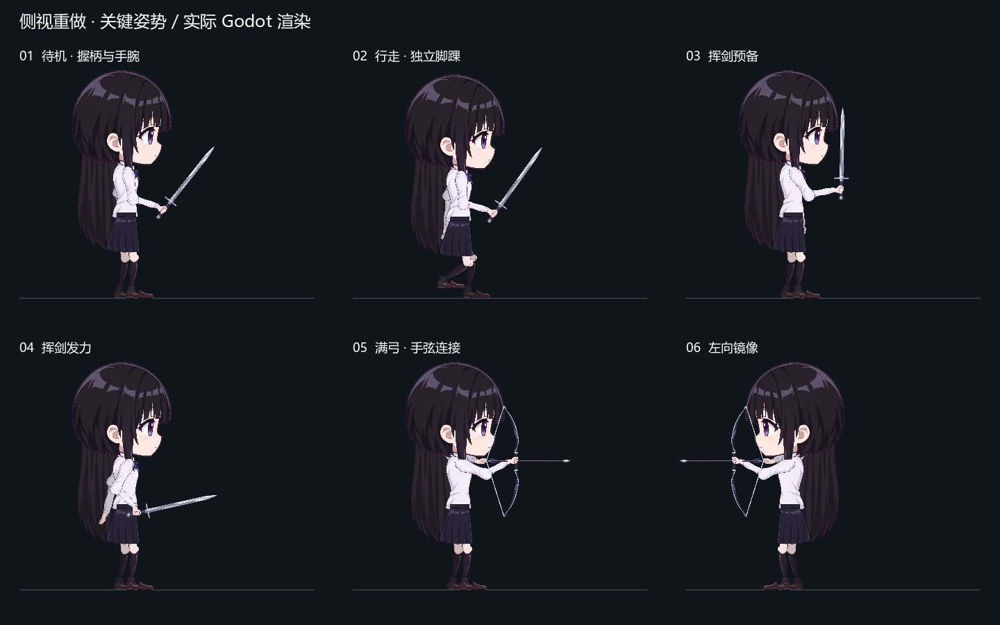

# 黑长直角色：侧视重做素材与绑定

本版只重做黑长直角色。外观为黑色长直发、白衬衫和深色百褶裙，统一向右侧视；向左时镜像整个绑定。旧 `assets/schoolgirl/` 留作历史素材，当前角色使用 `assets/schoolgirl_profile/`。

## 生成与透明处理

16 类素材分别通过内置 **image_gen** 生成，生成时要求原生透明背景。完整提示词见 [profile-prompts.json](profile-prompts.json)，原始 RGBA PNG 保存在 `assets/schoolgirl_profile/source/`。持剑手曾进行一次背景提取编辑，输出同样保留在来源目录。

| 文件名 | 独立控制的用途 |
| --- | --- |
| head / hair_back | 头部；背后长发，后者用 3 段骨骼驱动连续网格 |
| torso / skirt | 侧面衬衫躯干；裙摆 |
| upper_arm / forearm | 上臂；不包含手的前臂 |
| thigh / shin / foot | 大腿；小腿长袜；独立鞋与脚踝 |
| hand_sword / hand_bow / hand_pull / hand_relaxed | 持剑、握弓、拉弦、放松四种手型 |
| sword / bow / arrow | 剑、无弦弓、箭；弓弦由 Godot Line2D 绘制 |

近远侧肢体复用同款 PNG，但各有独立骨骼、Sprite2D 和动画轨道。头部当前为一张合并面部素材，眼睛、刘海与表情未继续拆分。

`tools/prepare_profile_art.py` 根据原始 Alpha 找出素材边界，裁掉外边距并补 4 像素透明边。Alpha≥8 只用于定位边界，裁切区域中的 RGBA 数据逐字节保持不变；没有按背景 RGB 推断透明度、重新描绘或程序生成美术。`parts.json` 记录原图尺寸、裁切框和输出尺寸，`rig_layout.json` 记录每个 Sprite 的位置和缩放。

## 原生场景与编辑入口

- `scenes/schoolgirl_rig.tscn`：独立绑定，20 个 Bone2D。`Locomotion` 管待机和步态，`Actions` 管上半身和武器动作。
- `Skeleton2D/Hips/Torso/ArmAim`：近远侧手臂。各自 `Hand` 是独立手腕，武器位于近手，`StringNock` 位于远手。
- `Skeleton2D/Hips/NearThigh` 与 `FarThigh`：大腿、小腿、脚踝；`Sole` 是鞋底测量点。
- `HairMesh`：Polygon2D 连续长发网格，3 个骨骼影响、16 个四边形；权重可在 Godot 中编辑。
- `scenes/profile_parts.tscn`：16 格原生部件预览，Tab 打开时展示。

`tools/build_profile_rig.py` 在离线制作阶段计算两段肢体角度，写成普通 `.tscn` 和 AnimationPlayer 关键帧。运行游戏时不创建骨架节点，也不执行自制 IK。重建命令如下：

```powershell
python tools/prepare_profile_art.py
python tools/build_profile_rig.py
```

第二条会覆盖 `schoolgirl_rig.tscn`、`profile_parts.tscn`、`rig_layout.json`；编辑器中的手动改动应先保存或提交，再决定是否重建。素材和动作自然度的取舍见 [研究记录](animation-research.md)。

## 可重复查看的结果



[连续键鼠操作视频](profile-motion.mp4) 由 Godot 原生 Movie Maker 输出，再用 FFmpeg 编码为 MP4，包含移动、剑击、拉弓、放箭、左转和部件面板。游戏窗口截图保存在 [待机图](profile-idle.png) 和 [拉弓图](profile-bow.png)。

`tests/profile_review.tscn` 可在编辑器直接运行；追加 `-- --capture-profile-review` 会保存 `.local/profile-review.png` 并退出。`tests/profile_motion.tscn` 通过 InputEvent 模拟输入，保存各阶段截图后自动退出，可配合 Godot `--fixed-fps 30 --write-movie .local/profile-motion.avi` 录制。`pwsh -NoProfile -File tools/check.ps1` 执行 43 项玩法和 8 项姿势检查，所有辅助进程限时退出。
