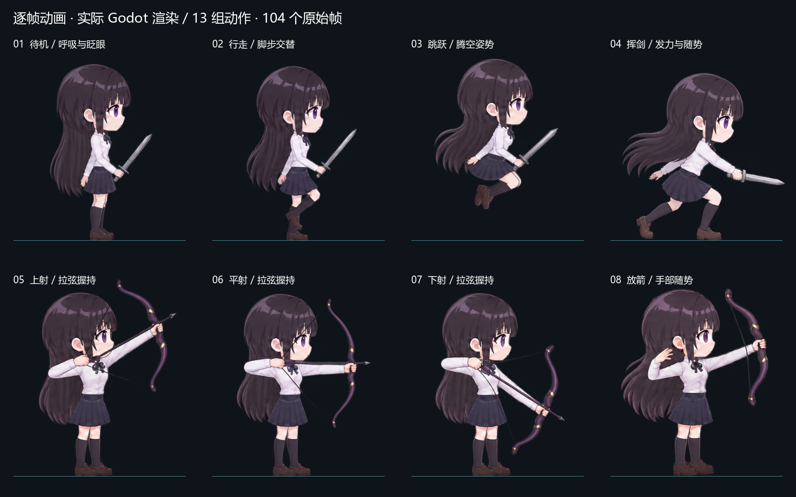
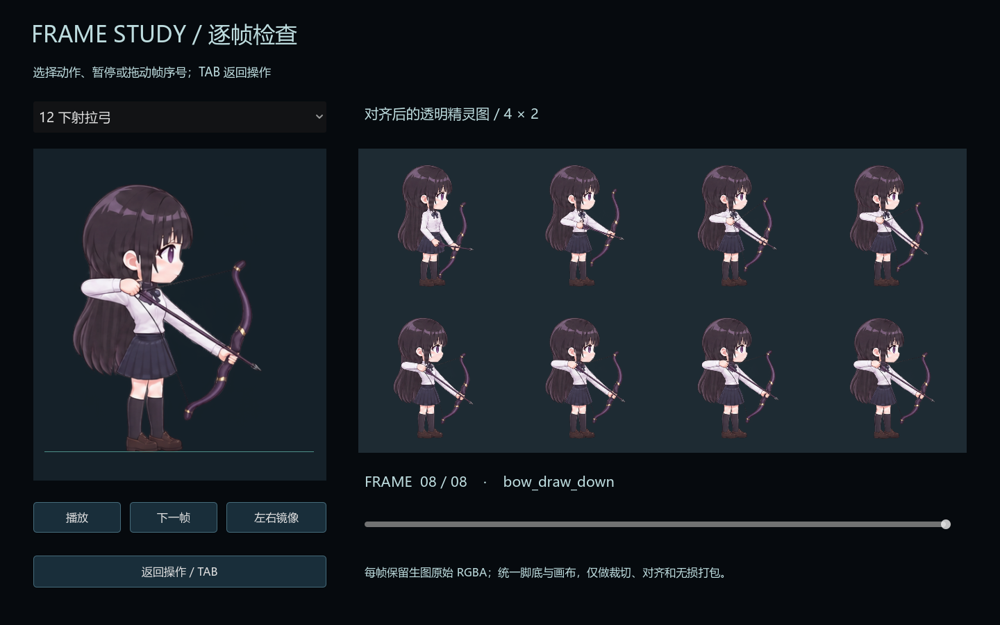

# 黑长直角色的 AI 逐帧动画

本版与分件骨骼版并存，用于比较完整绘制帧的动作表现。角色保持黑色长直发、紫色眼睛、白衬衫、深色百褶裙、长袜和棕色鞋，严格侧视，向左时整体镜像。通过主场景的 **F3** 进入，或直接运行 `scenes/sprite_lab.tscn`。



[连续操作视频](sprite-motion.mp4) 展示移动、跳跃、挥剑、三档射箭和动画检查面板。

## 动作与操作

| 原始序列 | 数量 | 播放方式 |
| --- | --- | --- |
| idle_sword / idle_bow | 2 × 8 帧 | 呼吸与眨眼循环，眨眼帧缩短停留 |
| walk_sword / walk_bow | 2 × 8 帧 | 12 FPS 基准，速度跟随移动，后退反向播放 |
| jump_sword / jump_bow | 2 × 8 帧 | 拆为起跳、空中和落地；空中姿势根据垂直速度选择 |
| slash | 1 × 8 帧 | 预备、发力、随势、恢复；命中只发生在发力帧 |
| bow_draw / bow_draw_up / bow_draw_down | 3 × 8 帧 | 约 0.8 秒蓄力，满弓停在最后一帧 |
| bow_release / bow_release_up / bow_release_down | 3 × 8 帧 | 释放与恢复，释放帧生成箭矢 |

共 **13 组、104 个原始绘制帧**。Godot 的 SpriteFrames 还包含 6 个复用原始帧的跳跃阶段定义。释放动画第一帧复用对应拉弓的最后一帧，避免满弓到释放时换用另一张生成姿势。

- A/D 横向移动；空格起跳，落地播放缓冲姿势。
- 鼠标决定左右朝向。相对角色肩部的鼠标角度低于 −15°、位于 ±15° 内、高于 15°，分别选择上、中、下档；箭矢初始角度对应 −30°、0°、30°，之后有重力下坠。
- Q 切换剑与弓。剑模式单击左键；弓模式按住左键蓄力，松开放箭。拉弓时切换瞄准档位保留当前帧和蓄力。
- 攻击在地面进行，并停下移动以保持整帧姿势的落脚关系。空中保留跳跃姿势，不播放站立攻击帧。
- Tab 打开或关闭动画检查面板；R 重置；F3 返回骨骼版。切换武器、打开检查面板或窗口失焦都会取消待发箭矢。

## 图像生成与质量检查

使用内置 **image_gen**，没有使用 API/CLI 后备方案。先生成持剑行走图作为统一参考，再按动作分别生成其余序列。每组采用 4×2 的八帧构图；三档拉弓和三档释放分别绘制，角色身体保持直立，不通过旋转整个人物伪造瞄准。

提示词与最终选中输出的标识保存在 [sprite-prompts.json](sprite-prompts.json)。持剑行走做过一次背景提取编辑；持弓行走与持弓跳跃出现多余手臂的帧，通过生图工具进行了定点修正。选中原始图均保存在 `assets/schoolgirl_frames/source/`，没有用程序重画角色或涂改错误关节。

质量核对覆盖了角色身份、服装、肢体数量、握持关系、动作顺序、镜像和画布裁切。另用 Godot 在深浅背景上实际渲染检查透明边缘。生成 PNG 的部分透明区域包含接近零的 Alpha 和不可见 RGB 信息；这些像素没有按 RGB 重新抠图或改写。

`tools/prepare_sprite_frames.py` 只根据原生 Alpha 定位边界与行间空隙，裁切后对齐、透明补边并无损打包。抬弓弓尖跨过名义网格中线时，使用实际透明间隙作为分行位置。裁切区域内的 RGBA 字节经过逐字节一致性断言，`frames.json` 记录原始裁切范围、原图轴心、补边位置和像素摘要。空中帧保持站立参考轴心，避免把蜷腿姿势错误地贴到地面。

## 资源与编辑

| 路径 | 内容 |
| --- | --- |
| assets/schoolgirl_frames/*.png | 13 张对齐后的精灵图，每张 2048×1024，4×2 格 |
| assets/schoolgirl_frames/frames/ | 104 张独立 PNG，每张 512×512 |
| assets/schoolgirl_frames/source/ | 13 张选中的原始 RGBA 图，1774×887 |
| assets/schoolgirl_frames/frames.json | 透明裁切、轴心与打包记录 |
| assets/schoolgirl_frames/schoolgirl_frames.tres | 可在编辑器中调整帧顺序、FPS、停留时间的原生 SpriteFrames |
| scenes/sprite_schoolgirl.tscn | CharacterBody2D、AnimatedSprite2D、碰撞与射箭位置标记 |
| scenes/sprite_lab.tscn | 独立可操作试验场、靶子、箭池及逐帧检查面板 |

统一画布轴心为 `(256, 464)`，游戏中以 0.6 倍显示。原始图和独立帧目录含 `.gdignore`，运行时只导入 13 张打包精灵图。原生场景中的节点预先保存，运行时没有拼装角色或动态创建动画资源。

重建需要 Python 和 Pillow：

```powershell
python tools/prepare_sprite_frames.py
python tools/build_sprite_lab.py
```

第一条覆盖对齐图、独立帧、裁切记录和 SpriteFrames；第二条覆盖逐帧试验场。手动在编辑器修改这些资源后，应先保存或提交，再决定是否重建。



## 验证与当前边界

Godot 4.6.3 / Windows 下，通过 26 项新增玩法检查、3 项场景入口检查，以及原有 51 项骨骼版检查，共 **80 项**。跳跃落地、在剑击结束帧再次攻击、三档箭矢实际命中、镜像、取消蓄力、面板拖帧和场景往返均已验证。重建工具同时验证所有 104 帧复制区域的像素不变。

运行 `pwsh -NoProfile -File tools/check.ps1` 可执行检查。`tests/sprite_review.tscn` 展示关键姿势；`tests/sprite_motion.tscn` 使用 InputEvent 模拟连续操作，可配合 Godot Movie Maker 录制。所有验证进程限时退出。

这是每组八个绘制帧的动作试验，帧间仍有少量线条和轮廓变化；它不等同于手工绘制的大量连续补间帧，也没有复现骨骼版的脚底锁定精度。三档瞄准是离散姿势；受击、死亡、空中攻击和更多观察方向未包含在本轮动作集中。动画检查面板用于后续逐帧筛选和替换，不把逻辑测试通过当作全部视觉质量的证明。
